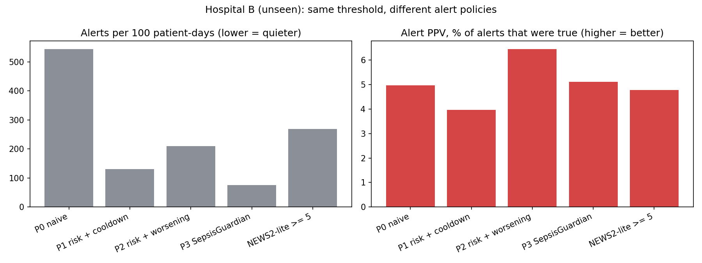
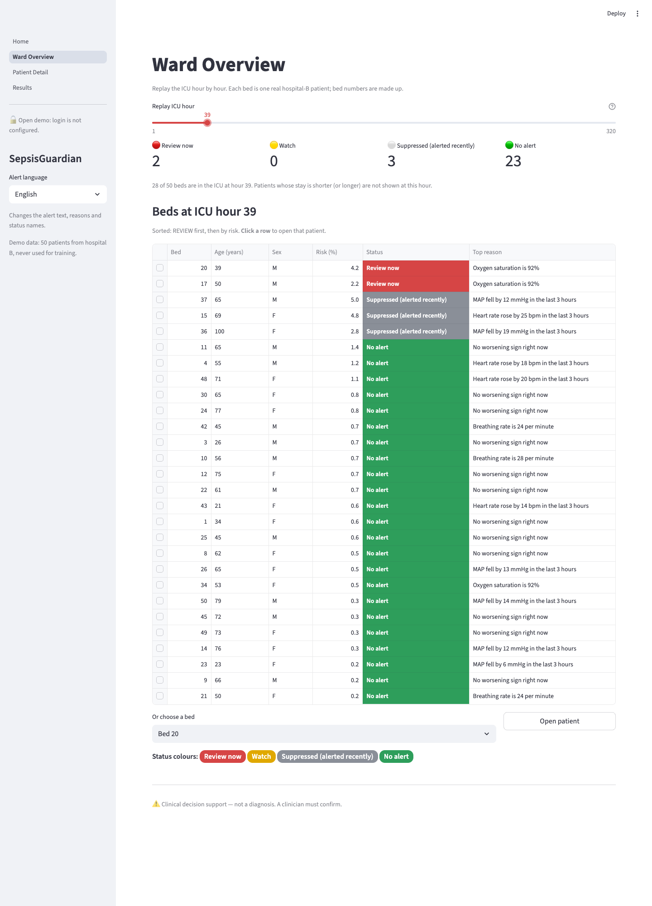
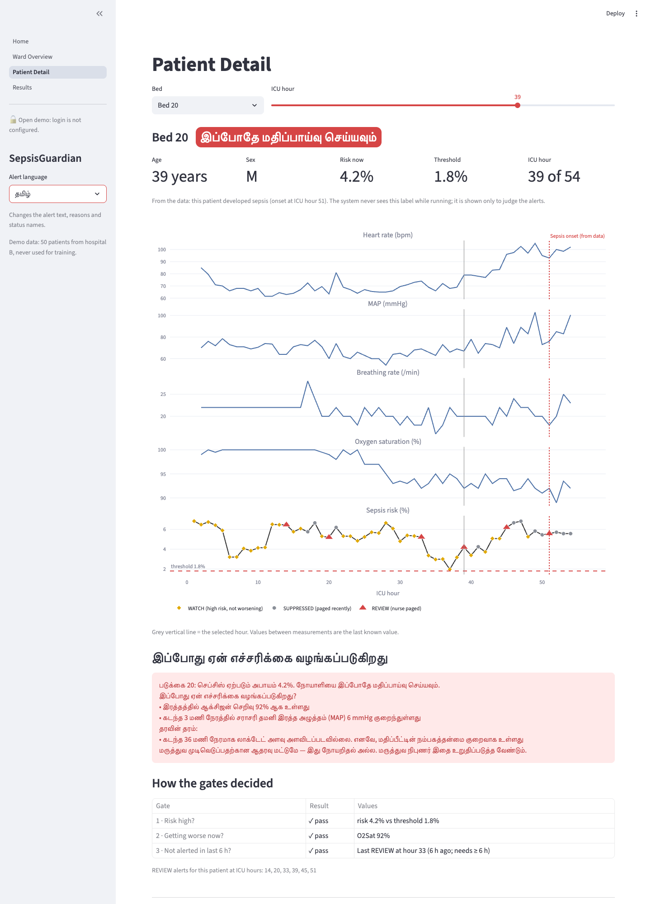
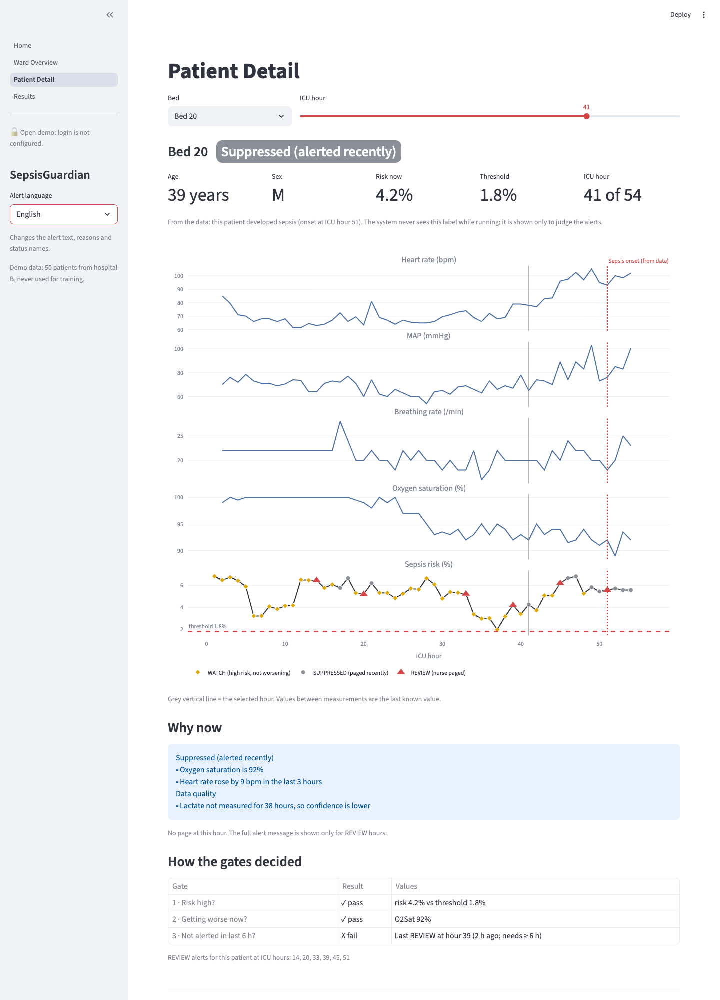
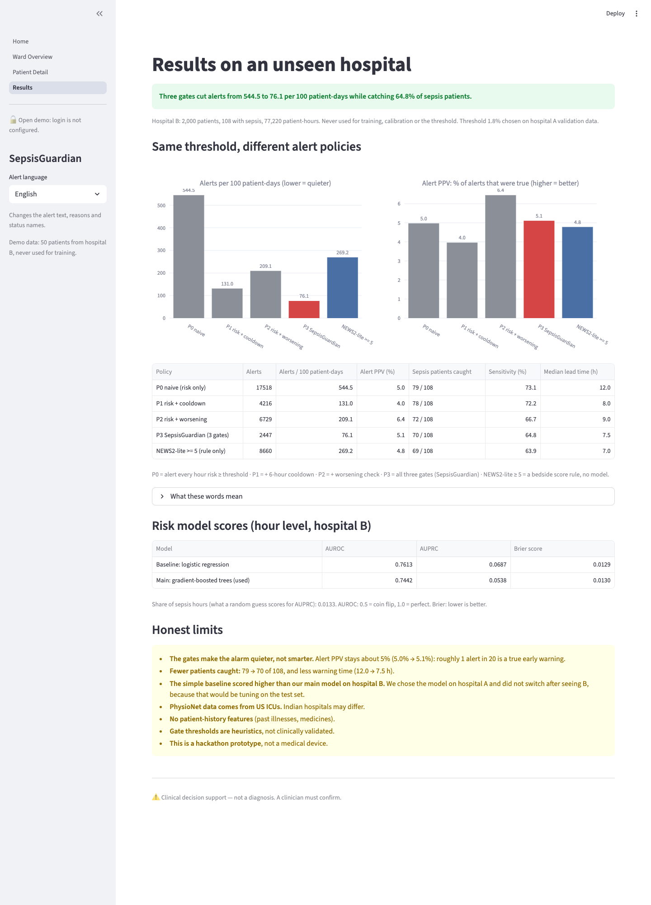

# 🩺 SepsisGuardian

**Calibrated sepsis risk + a three-gate alert controller + plain-language reasons in English, தமிழ் and हिन्दी.
Decision support, not diagnosis.**

DEXATHON 2026 · Healthcare (MedTech & Clinical Intelligence) · Team **HackNovacX** (DEX26048)

> ⚠️ **Clinical decision support — not a diagnosis. A clinician must confirm.**

**Live demo:** _link to be added_ · **Demo video:** _link to be added_

---

## The problem
- **Sepsis** is the body's extreme response to an infection. Every hour of delay raises the risk of death.
- Hospital alert tools fire so often that nurses learn to ignore them (**alert fatigue**).
- An external check of one widely used sepsis model found it **missed 67%** of sepsis patients, and only
  **12% of its alerts were correct** (Wong et al., 2021).

## Our idea
A risk score alone is not enough to page a nurse. A sick patient stays "high risk" for hours, so a risk-only
system pages again and again. **SepsisGuardian pages the nurse only when three gates all pass:**

| Gate | Question | Rule (editable in `src/config.py`) | If it fails |
|---|---|---|---|
| 1 · Risk | Is the risk high? | risk ≥ **1.8%** (chosen on validation data) | 🟢 NO ALERT |
| 2 · Worsening | Is the patient getting worse **now**? | any of: MAP fell ≥ 10 mmHg in 3 h · heart rate rose ≥ 15 bpm in 3 h · lactate rose ≥ 0.5 mmol/L in 3 h · breathing ≥ 24/min · oxygen ≤ 92% | 🟡 WATCH (no page) |
| 3 · New | Not paged recently? | no REVIEW alert in the previous 6 hours | ⚪ SUPPRESSED (logged) |
| All pass | | | 🔴 **REVIEW** (nurse paged) |

Every alert says **why now** in the nurse's language ("MAP fell by 21 mmHg in the last 3 hours") and warns
when data is missing ("Lactate not measured yet, so confidence is lower").
A missing measurement never counts as "getting worse". The thresholds are heuristics, **not clinically validated**.

## How it works
```
1. ICU data      PhysioNet/CinC 2019: real, de-identified, hourly vitals + labs (2 US hospital systems)
        ↓
2. Features      51 numbers per patient-hour, from PAST hours only (3-h changes, 6-h windows, NEWS2-lite)
        ↓
3. Risk model    gradient-boosted trees, isotonic calibration → risk %   (trained on hospital A)
        ↓
4. Three gates   risk high? → getting worse now? → not paged in 6 h? → page the nurse
        ↓
5. Explain       "why now" + data-quality notes in English / தமிழ் / हिन्दी (fixed, reviewed templates)
```

## Results — on a hospital the model never saw
Trained and tuned on **hospital A**. Tested once on **hospital B**: 2,000 patients, 108 with sepsis, 77,220 patient-hours.

> **Three gates cut alerts from 544.5 to 76.1 per 100 patient-days while catching 64.8% of sepsis patients.**

| Alert policy (same threshold 1.8%) | Alerts / 100 patient-days | Alert PPV | Sepsis patients caught (≤ onset) | Median lead time |
|---|---|---|---|---|
| P0 · risk only | 544.5 | 5.0% | 79 / 108 (73.1%) | 12.0 h |
| P1 · risk + cooldown | 131.0 | 4.0% | 78 / 108 (72.2%) | 8.0 h |
| P2 · risk + worsening | 209.1 | 6.4% | 72 / 108 (66.7%) | 9.0 h |
| **P3 · SepsisGuardian (3 gates)** | **76.1** | **5.1%** | **70 / 108 (64.8%)** | **7.5 h** |
| NEWS2-lite ≥ 5 (bedside score, no model) | 269.2 | 4.8% | 69 / 108 (63.9%) | 7.0 h |

| Risk model (hour level, hospital B) | AUROC | AUPRC | Brier |
|---|---|---|---|
| Baseline: logistic regression | 0.761 | 0.069 | 0.0129 |
| Main: gradient-boosted trees (used) | 0.744 | 0.054 | 0.0130 |



**Honest reading**
- ✅ The gates make the alarm **7.2× quieter**, and 3.5× quieter than a NEWS2-style rule at about the same sensitivity.
- ⚠️ They make it quieter, **not smarter**: alert PPV stays about 5% (about 1 alert in 20 is a true early warning).
- ⚠️ Cost: 9 fewer sepsis patients caught (79 → 70) and less warning time (12 → 7.5 h).
- ⚠️ The simple baseline scored higher than our main model on hospital B. We chose the model on hospital A and
  did **not** switch after seeing B; that would be tuning on the test set.

All numbers come from `results/metrics.json`, produced by `src/evaluate.py`. Definitions are in
[docs/DATA_AND_MODEL.md](docs/DATA_AND_MODEL.md).

## Screenshots
| Ward Overview: replay the ICU hour by hour | Patient Detail: REVIEW alert in Tamil |
|---|---|
|  |  |

| Gate 3 at work: SUPPRESSED (paged 2 h ago) | Results |
|---|---|
|  |  |

## Tech stack
| Part | Tools |
|---|---|
| Language | Python 3.9 (laptop) · Python 3.12 (Streamlit Cloud) |
| Data | pandas 2.2, NumPy 1.26 |
| Model | scikit-learn 1.5: HistGradientBoostingClassifier, LogisticRegression, isotonic calibration |
| Website | Streamlit 1.50, Plotly 5.24 |
| Login (optional) | Streamlit `st.login` + Clerk (OpenID Connect), Authlib 1.6.5 (pinned) |
| Charts for docs | Matplotlib 3.9 |
| Tests | pytest 8 (49 tests) |
| Data source | PhysioNet/CinC Challenge 2019 (open access) |

## Run it locally
The website runs from the small files in `app/demo_data/`. **No download is needed to see it.**
```bash
git clone https://github.com/wyzer-coder/SEPSISGUARDIAN.git
cd SEPSISGUARDIAN
python3 -m venv .venv
.venv/bin/pip install -r requirements.txt
.venv/bin/streamlit run app/Home.py
```

Rebuild everything from the raw data (about 25 MB download, then a few minutes):
```bash
.venv/bin/python scripts/download_data.py      # 2,000 patients per hospital (resume-safe)
.venv/bin/python -m src.train                  # hospital A: model + threshold (with the gates)
.venv/bin/python -m src.evaluate               # hospital B: metrics + gate comparison
.venv/bin/python scripts/build_demo_data.py    # 50 demo beds for the website
.venv/bin/pytest -q                            # 49 tests
```
Results are reproducible: seed 42 everywhere; re-running training gives identical files.

### Optional: staff login (Clerk)
Without login settings the website is an open demo. To require sign-in, copy
`.streamlit/secrets.toml.example` to `.streamlit/secrets.toml` and fill in your Clerk OAuth details.
Every page then shows only a **Sign in** button until the user signs in through Clerk.
Step-by-step guide: [docs/LOGIN_SETUP.md](docs/LOGIN_SETUP.md). The secrets file is never committed.

## Project structure
```
SEPSISGUARDIAN/
├── app/                  the website (Streamlit)
│   ├── Home.py           about page
│   ├── pages/            Ward Overview · Patient Detail · Results
│   ├── utils.py          shared loading, colours, gate table
│   └── demo_data/        50 demo patients, metrics, model (6.2 MB)
├── src/                  the pipeline
│   ├── config.py         ALL thresholds, paths and seeds
│   ├── load_data.py      read the hourly files
│   ├── features.py       leakage-safe features
│   ├── train.py          model, calibration, threshold (hospital A only)
│   ├── gates.py          the three-gate alert controller
│   ├── evaluate.py       hospital B metrics, P0–P3 comparison
│   ├── explain.py        why-now reasons + data-quality notes
│   └── messages.py       English / Tamil / Hindi templates
├── scripts/              download_data.py · build_demo_data.py
├── tests/                49 tests (leakage, gates, metrics, messages, login, …)
├── results/              metrics.json, comparison table and chart
└── docs/                 design, data and model, decisions, Q&A, demo script
```
Raw data (`data/`) is never committed.

## Limitations and safety
- **Decision support, not diagnosis.** A clinician must confirm every alert.
- PhysioNet data comes from US ICUs; Indian hospitals may differ.
- No patient-history features (past illnesses, medicines).
- Gate thresholds are heuristics, not clinically validated.
- About 1 alert in 20 is a true early warning; the model is modest (AUROC 0.74).
- Hackathon prototype, not a medical device.

## Team
**HackNovacX** · Team ID DEX26048 · DEXATHON 2026, Sathyabama Institute of Science and Technology, Chennai

## References
- Wong A. et al. External validation of a widely implemented proprietary sepsis prediction model in hospitalized patients. *JAMA Internal Medicine*, 2021.
- Reyna M. A. et al. Early prediction of sepsis from clinical data: the PhysioNet/Computing in Cardiology Challenge 2019. *Critical Care Medicine*, 2020.
- Singer M. et al. The Third International Consensus Definitions for Sepsis and Septic Shock (Sepsis-3). *JAMA*, 2016.
- Adams R. et al. Prospective, multi-site study of patient outcomes after implementation of the TREWS machine learning-based early warning system for sepsis. *Nature Medicine*, 2022.
- Data: [PhysioNet/CinC Challenge 2019](https://physionet.org/content/challenge-2019/1.0.0/).

## AI assistance
We used Claude (an AI assistant) openly to help write the code and documentation, including the gate
controller; the Tamil text was provided by the team; the team chose the problem and the three-gate idea,
reviewed every file and ran every test.
